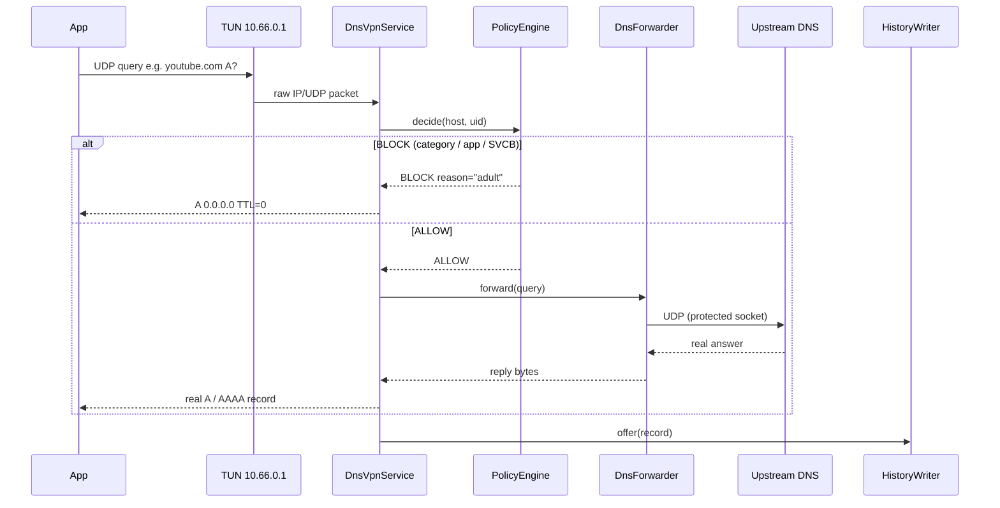
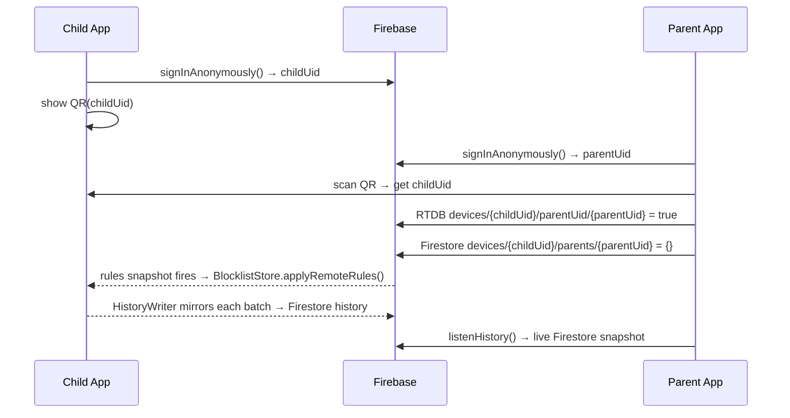

<div align="center">

# 🛡️ Tracewall

**On-device DNS filtering for Android — no root, no server, no account required.**

A local `VpnService` intercepts every DNS query on the child's phone, runs it
through a layered policy engine in microseconds, and shows the result live —
down to exactly which app asked for which name.  
Since **v2**, a companion parent app and Firebase backend let a parent push rules
and read history from any device, in real time.

[](https://openjdk.org/)
[-brightgreen?logo=android>)](https://developer.android.com/about/versions/nougat)
[](https://developer.android.com/build/releases/gradle-plugin)
[](https://junit.org/junit5/)
[](https://firebase.google.com/)
[](https://github.com/STARFALL088/Tracewall/releases/tag/v2)

</div>

---

## Table of Contents

- [What it does](#what-it-does)
- [Live demo](#live-demo-v1-verified-on-emulator-api-37)
- [Architecture](#architecture)
- [Versions](#versions)
- [Modules & code layout](#modules--code-layout)
- [How the tunnel works](#how-the-tunnel-works)
- [Rule precedence](#rule-precedence)
- [Parent sync — Firebase](#parent-sync--firebase)
- [Firebase setup](#firebase-setup)
- [Build](#build)
- [Status](#status)
- [Known gaps](#known-gaps)
- [Rule data](#rule-data)

---

## What it does

| Feature                   | Detail                                                                                            |
| ------------------------- | ------------------------------------------------------------------------------------------------- |
| **DNS-only VPN tunnel**   | Routes only `10.66.0.1/32` — one address — so a bug here can affect nothing but name resolution   |
| **Per-app attribution**   | Every query is tagged with the Android UID that sent it using `ConnectivityManager` socket tables |
| **Category blocking**     | Four built-in lists: `malware`, `gambling`, `adult`, `ads`                                        |
| **Per-app blocking**      | Block an entire app's DNS traffic from a long-press or the Apps screen                            |
| **Allowlist override**    | Explicit allows win over every category — long-press any blocked row                              |
| **Live query log**        | 500-entry in-memory ring, refreshed every 700 ms, with a custom trend bar chart                   |
| **Room history**          | Batched writes (1.5 s flush), one-week retention, exported via `ContentProvider`                  |
| **Remote rules (v2)**     | Parent pushes allow list, blocked UIDs and active categories from their phone via RTDB            |
| **Remote history (v2)**   | Every query is mirrored to Firestore; parent reads it live from the dashboard                     |
| **QR pairing (v2)**       | Child shows its Firebase UID as a QR code; parent scans it — no typing                            |
| **Private DNS warning**   | Banner appears when `Settings.Global.private_dns_mode` is non-`off`                               |
| **SVCB / HTTPS blocking** | Types 64 + 65 return NXDOMAIN immediately, closing the DoH auto-discovery path                    |
| **Bilingual**             | Full English and Bengali (`values-bn/`) string resources                                          |

---

## Live demo — v1, verified on emulator API 37

```
$ adb shell ping -c 1 example.com          # not in any list → forwarded
PING example.com (104.20.23.154)

$ adb shell ping -c 1 xvideos.com          # category: adult → sinkholed
PING xvideos.com (127.0.0.1)              # 0.0.0.0 written as loopback by ping

$ adb shell ping -c 1 pornhub.com          # same category, but long-pressed → Allow
PING pornhub.com (66.254.114.41)           # allowlist beats category, live

$ adb shell ping -c 1 _dns.resolver.arpa   # SVCB discovery (v2) → NXDOMAIN
ping: _dns.resolver.arpa: No address associated with hostname
```

The header read `Rules: 516` after the allowlist entry — the policy engine
reloaded in place without restarting the tunnel. Screenshots are in
`docs/screenshots/`.

---

## Architecture

### System overview


### DNS packet flow



---

## Versions

|                     | **v1**                                                           | **v2**                                                           |
| ------------------- | ---------------------------------------------------------------- | ---------------------------------------------------------------- |
| **Tag**             | [`v1`](https://github.com/STARFALL088/Tracewall/releases/tag/v1) | [`v2`](https://github.com/STARFALL088/Tracewall/releases/tag/v2) |
| **Date**            | 2026-10-20                                                       | 2026-10-26                                                       |
| **Modules**         | `blocklist`, `app`                                               | `blocklist`, `app`, `parent`                                     |
| **Network**         | None                                                             | Firebase (Auth, RTDB, Firestore)                                 |
| **Tests**           | 76                                                               | 77                                                               |
| **Device-verified** | ✅ Full                                                          | 🔄 Compiles; Firebase paths need real `google-services.json`     |

```bash
git checkout v1   # standalone filter — everything verified on device
git checkout v2   # full feature set — current HEAD
```

### What v2 added over v1

<details>
<summary><strong>Click to expand full changelog</strong></summary>

| Area                               | Change                                                                                                                                                                       |
| ---------------------------------- | ---------------------------------------------------------------------------------------------------------------------------------------------------------------------------- |
| **Firebase Auth**                  | `TracewallApp` signs in anonymously on startup; the UID is the shared secret for all Firebase paths                                                                          |
| **Realtime Database**              | `FirebaseSync.listenForRules()` subscribes to `/devices/{uid}/rules`; reloads `BlocklistStore` atomically on any parent write                                                |
| **Firestore**                      | `HistoryWriter` mirrors each batch to `/devices/{uid}/history` after the Room insert; Firestore SDK queues writes offline                                                    |
| **Offline persistence**            | Both databases enable on-disk caching before any reference is obtained                                                                                                       |
| **`:parent` module**               | Second Android app: `PairingActivity` (QR scan or manual entry), `DashboardActivity` (live history, allow/block/category controls)                                           |
| **Remote rules**                   | Parent-pushed allow list, blocked UIDs and category set stored under separate SharedPreferences keys and merged with local rules; parent never erases what child set locally |
| **Remote category toggle**         | Four switches in the parent dashboard; each change writes to `rules/categories` via `updateChildren` so it does not overwrite allow/block rules                              |
| **QR pairing**                     | Child: tap device-code label → 512×512 QR dialog (ZXing core); long-press → copy UID to clipboard. Parent: "Scan QR" button using `zxing-android-embedded` + `ScanContract`  |
| **Private DNS warning**            | Yellow banner in `MainActivity` when `Settings.Global.private_dns_mode ≠ off`; re-checked on every `onResume`                                                                |
| **SVCB / HTTPS blocking**          | `TYPE_SVCB=64`, `TYPE_HTTPS=65` added to `DnsMessage`; `DnsVpnService` returns NXDOMAIN before any policy check, closing the `_dns.resolver.arpa` DoH-discovery path         |
| **`AtomicBoolean`**                | `DnsVpnService.running` was `volatile boolean`; replaced with `AtomicBoolean` to remove the data-race between tunnel thread, `teardown()` and binder-thread `onDestroy()`    |
| **BootReceiver pre-warm**          | `FirebaseSync.signInAnonymously()` called at boot when protection was previously enabled                                                                                     |
| **Security rules**                 | `firebase/database.rules.json` + `firebase/firestore.rules` committed alongside the code; locked to `auth.uid` with parent-pairing carve-out                                 |
| **`google-services.json.example`** | Template committed in `app/` so contributors know what to fill in                                                                                                            |

</details>

---

## Modules & code layout

```
Tracewall/
├── blocklist/              Pure JVM — no android.* imports. Testable with just a JDK.
│   └── src/main/java/
│       ├── tracewall/net/
│       │   ├── DnsMessage.java       RFC 1035 wire codec: parse, build, compress, SVCB
│       │   ├── IpPacket.java         IPv4/IPv6 + UDP codec, real RFC 1071 checksums
│       │   └── DnsForwarder.java     Upstream UDP; TCP retry on TC=1; socket pool
│       └── tracewall/blocklist/
│           ├── DomainPattern.java    Exact + label-aligned wildcard matching
│           ├── DomainSet.java        HashSet (exact) + list (wildcards); O(1) exact lookup
│           ├── HostListParser.java   Hosts-format parser; counts malformed + duplicate
│           └── PolicyEngine.java     Immutable; precedence: allow > app > category > default
│
├── app/                    Child's phone. Needs Android SDK.
│   └── src/main/java/tracewall/child/
│       ├── TracewallApp.java         Application: Firebase sign-in + rules listener
│       ├── MainActivity.java         Toggle, live log, trend chart, Private DNS warning
│       ├── block/
│       │   └── BlocklistStore.java   Singleton rule store; atomic engine swap on reload
│       ├── log/
│       │   ├── HistoryWriter.java    Batched Room writer + Firestore mirror
│       │   ├── QueryLog.java         500-entry in-memory ring for the live UI
│       │   ├── QueryRecord.java      Room @Entity
│       │   ├── QueryDao.java         Room DAO: insertAll, prune
│       │   ├── TracewallDb.java      Room database, WAL mode
│       │   └── QueryLogProvider.java Read-only ContentProvider (exported=false)
│       ├── sync/
│       │   └── FirebaseSync.java     Facade: Auth, RTDB rules listener, Firestore logQuery
│       ├── ui/
│       │   ├── AppBlockActivity.java Per-app blocking list with search
│       │   ├── AppBlockAdapter.java  RecyclerView adapter, toggle per app
│       │   ├── QueryAdapter.java     History rows; long-press → allow / block app
│       │   ├── TrendView.java        Custom View: buckets queries into 1-min bars
│       │   └── Notifications.java   "Protection is off" notification
│       ├── vpn/
│       │   ├── DnsVpnService.java    TUN loop, worker pool, SVCB blocking
│       │   └── UidAttributor.java    Maps (srcIp, srcPort) → Android UID
│       └── boot/
│           └── BootReceiver.java     BOOT_COMPLETED: notify + pre-warm Firebase
│
├── parent/                 Parent's phone. Second APK, same Firebase project.
│   └── src/main/java/tracewall/parent/
│       ├── TracewallParentApp.java   Application: anonymous Firebase sign-in
│       ├── PairingActivity.java      Enter child UID or scan QR; registerAsParent
│       ├── DashboardActivity.java    Live history + allow/block/category rule forms
│       └── sync/
│           └── FirebaseParent.java   registerAsParent, pushRules, pushCategories, listenHistory
│
└── firebase/               Security rules — deploy with Firebase CLI.
    ├── database.rules.json           RTDB: auth.uid === $uid || parent lookup
    └── firestore.rules               Firestore: same + /devices/{uid}/parents/{parentUid}
```

**Why the split?** The hardest code — wire formats, real checksums — lives in
`blocklist/` with zero Android dependencies. `./gradlew :blocklist:test` runs all
77 tests on any laptop with just a JDK, including checksum re-verification
against an independent RFC 1071 reference and 11 policy-precedence tests.
No emulator needed.

---

## How the tunnel works

```
Device address   10.66.0.2/24
Advertised DNS   10.66.0.1
Routed           10.66.0.1/32 only    ← one address, nothing else enters the tunnel
```

Only packets destined for `10.66.0.1:53` enter the TUN file descriptor. A bug
here can sink DNS; it cannot route arbitrary traffic or MITM HTTPS.

**Packet handling (per-query, on a worker thread):**

1. `IpPacket.parse()` decodes the outer IPv4 or IPv6/UDP header.
2. `DnsMessage.parse()` decodes the DNS question. Non-DNS or malformed → dropped.
3. `TYPE_SVCB` / `TYPE_HTTPS` (64/65) → **NXDOMAIN** immediately.
   This kills the `_dns.resolver.arpa` auto-discovery that would let the OS find
   a DoH/DoT server to route around the filter.
4. `PolicyEngine.decide(host, uid)` evaluates the query (see precedence below).
5. **Block** → `DnsMessage.buildAResponse(q, 0.0.0.0)`. TTL=0 so the client
   never caches the lie.
6. **Allow** → `DnsForwarder.forward()` sends the query on a `protect()`-ed
   socket. Without `protect()` the forwarder's own queries go back into the
   tunnel and loop until file descriptors run out.
7. The reply is rebuilt with correct IPv4 header and UDP checksums.
   Android does not fix those up on a TUN write; a bad checksum means the
   client silently discards the answer with no visible error.
8. `HistoryWriter.offer(record)` hands the entry to the 1.5 s batch loop.

The service follows the default network via `ConnectivityManager.NetworkCallback`,
so a Wi-Fi → mobile handover rebuilds the forwarder socket pool instead of
leaving every lookup to time out.

---

## Rule precedence

```
  ┌───────────────────────────────────────────────────┐
  │  1. Explicit ALLOW  (exact or wildcard)           │  ← wins over everything below
  │     Long-press a blocked row  –or–  parent push   │
  ├───────────────────────────────────────────────────┤
  │  2. Per-app BLOCK  (whole Android UID)            │  ← beats categories
  │     AppBlockActivity toggle  –or–  parent push    │
  ├───────────────────────────────────────────────────┤
  │  3. Category BLOCK  (malware / gambling /         │  ← beats default
  │     adult / ads)   parent can toggle each live    │
  ├───────────────────────────────────────────────────┤
  │  4. Default ALLOW                                 │
  └───────────────────────────────────────────────────┘
```

Categories are loaded into a `TreeMap` so when a host appears in two of them it
always reports the alphabetically-first reason — deterministic across restarts and
devices.

**Rule merging (v2).** Local rules (set on the child's device) and remote rules
(pushed by the parent) are merged before the `PolicyEngine` is built:

- **Allow list** and **blocked UIDs** → union of local + remote. The parent can
  add entries without erasing anything the child set locally, and vice versa.
- **Active categories** → remote **replaces** local when the parent has set them;
  otherwise the device default (all four) applies. This lets the parent switch
  off `ads` without the child being able to re-enable `adult`.

---

## Parent sync — Firebase

Realtime Database carries rules (low latency, parent → child).
Firestore carries history (queryable, child → parent).

### Data schema

```
Realtime Database
└── devices/
    └── {childUid}/
        ├── rules/
        │   ├── allow/           {0: "example.com", 1: "*.safe.org", ...}
        │   ├── blocked_uids/    {0: 10123, 1: 10456, ...}
        │   └── categories/      {malware: true, gambling: true, adult: true, ads: false}
        └── parentUid/
            └── {parentUid}: true               ← written by registerAsParent()

Firestore
└── devices/
    └── {childUid}/
        ├── history/
        │   └── {auto-id}        {time_ms, host, blocked, app_uid, policy}
        └── parents/
            └── {parentUid}: {}                 ← mirrors RTDB for Firestore rules
```

### Pairing flow



### Security model — honestly

The child's Firebase UID is the shared secret that grants parent access.
The `parentUid` sub-tree is writable by any authenticated user — so anyone who
learns the child UID can register as a parent. A 28-character random string shown
only on the child's screen is good enough for a course project, but is not a
substitute for a real pairing handshake (e.g. a one-time code the child must
approve). **Treat the device code like a password.**

Security rules are in `firebase/` and are in version control, but they are **not
active until deployed** (see [Firebase setup](#firebase-setup)).

---

## Firebase setup

> Skip this entirely if you only want to run the local filter (v1 behaviour).
> Firebase is optional; every DNS decision still happens on-device.

**1. Create a project**

- [console.firebase.google.com](https://console.firebase.google.com) → New project
- Enable **Anonymous** sign-in (Authentication → Sign-in method)
- Create a **Realtime Database** (start in locked mode)
- Create a **Firestore** database (start in production mode)

**2. Add Android apps**

Add two Android apps to the project:

| App              | Package name       | Config file destination       |
| ---------------- | ------------------ | ----------------------------- |
| Tracewall Child  | `tracewall.child`  | `app/google-services.json`    |
| Tracewall Parent | `tracewall.parent` | `parent/google-services.json` |

Both files are gitignored. The committed copies are placeholders;
`app/google-services.json.example` shows the required shape.
**Every Firebase call fails at runtime until these are replaced.**

**3. Deploy security rules**

```bash
npm install -g firebase-tools
firebase login
firebase init   # select your project; choose Realtime Database + Firestore
firebase deploy --only database,firestore:rules
```

The rules are already written in `firebase/`; the `firebase init` step just
creates the local config pointing at your project.

---

## Build

**Prerequisites:** JDK 17 (pinned in `gradle.properties`), Android SDK with
`compileSdk 34`. Gradle 8.9 is pinned in the wrapper — AGP 8.5 is incompatible
with both JDK 27 and Gradle 9, and both failures are opaque.

```bash
# Run the pure-JVM engine tests (no emulator, no SDK needed)
./gradlew :blocklist:test

# Build the child APK
./gradlew :app:assembleDebug
# → app/build/outputs/apk/debug/app-debug.apk

# Build the parent APK
./gradlew :parent:assembleDebug
# → parent/build/outputs/apk/debug/parent-debug.apk

# Install child on a connected device / emulator
adb install -r app/build/outputs/apk/debug/app-debug.apk

# Regenerate the malware blocklist from abuse.ch URLhaus
./scripts/fetch-malware-list.sh
```

---

## Status

| Feature                                        | Status                   | Notes                                    |
| ---------------------------------------------- | ------------------------ | ---------------------------------------- |
| DNS interception (VpnService)                  | ✅ Verified on device    | Emulator API 37                          |
| Category blocking (malware/gambling/adult/ads) | ✅ Verified              | 4 built-in lists, hot-reload             |
| Per-app attribution                            | ✅ Verified              | `ConnectivityManager` UID lookup         |
| Per-app blocking (list screen)                 | ✅ Verified              | `AppBlockActivity`, toggle per app       |
| Allowlist override                             | ✅ Verified              | Long-press any blocked row               |
| Live query log                                 | ✅ Verified              | 500-entry ring, 700 ms refresh           |
| Custom trend bar chart                         | ✅ Verified              | 1-min buckets, `TrendView` custom view   |
| Room history + ContentProvider                 | ✅ Verified              | 1.5 s batch, 1-week retention            |
| CSV export                                     | ✅ Verified              | Copies to clipboard                      |
| Bilingual (English + Bengali)                  | ✅ Verified              | `values-bn/`                             |
| Boot notification                              | ✅ Verified              | `BootReceiver`                           |
| SVCB / HTTPS type blocking                     | ✅ Compiled, 77/77 tests | Closes DoH discovery path                |
| Private DNS warning banner                     | ✅ Compiled              | Reads `Settings.Global` on resume        |
| Firebase Auth (anonymous)                      | 🔄 Compiles              | Needs real `google-services.json`        |
| Realtime Database rules listener               | 🔄 Compiles              | Needs real `google-services.json`        |
| Firestore history mirror                       | 🔄 Compiles              | Needs real `google-services.json`        |
| Remote category toggles                        | 🔄 Compiles              | RTDB `rules/categories`                  |
| QR pairing — child (generate)                  | 🔄 Compiles              | ZXing core, tap device-code label        |
| QR pairing — parent (scan)                     | 🔄 Compiles              | `zxing-android-embedded`, `ScanContract` |
| Parent app — pairing screen                    | 🔄 Compiles              | `PairingActivity`                        |
| Parent app — dashboard / rules                 | 🔄 Compiles              | `DashboardActivity`                      |
| Parent app — live history                      | 🔄 Compiles              | Firestore snapshot listener              |

**Key:** ✅ Device-verified &nbsp;|&nbsp; 🔄 Compiles, not yet on device &nbsp;|&nbsp; ⚠️ Known gap

---

## Known gaps

These are honest, not excuses — the filter works correctly for everything in ✅ above.

- **`pushRules` is replace-not-merge.** The parent dashboard pushes one allow
  entry at a time, but each push replaces the entire `allow` sub-node, so a
  second allow wipes the first. The parent should maintain the full list locally
  and push it whole, or the RTDB listener should read-modify-write.

- **Parent-side UID entry has no app picker.** The dashboard takes a raw
  Android UID to block. The parent app cannot see the child's installed app list
  (it is on a different device), so there is no friendly name-to-UID resolver.

- **No Firestore retention.** The Firestore history collection grows unboundedly.
  The on-device Room database prunes rows older than one week; the Firestore
  mirror has no equivalent TTL or Cloud Function cleanup job.

- **Pairing is first-write-wins.** The `parentUid` sub-tree is writable by any
  authenticated user who knows the `childUid`. The 28-character UID is a
  reasonable shared secret for a course project but is not production-grade
  pairing security.

- **NXDOMAIN for HTTPS (type 65) is a blunt instrument.** It also blocks the
  `HTTPS` record optimisation that CDNs use to advertise QUIC / HTTP/3. Clients
  fall back to plain A/AAAA and still work, but the first-hop latency hint is
  lost.

- **UDP DNS only; IPv4 tunnel only.** No DNS-over-TLS upstream (the filter itself
  sees all queries in plaintext regardless — it intercepts before encryption).

- **Private DNS is warned, not disabled.** A determined user can keep Private DNS
  on. Always-on VPN (Android Settings → Network → VPN) is the proper fix and
  is not yet guided from within the app.

- **VPN cannot self-restart after a reboot.** `BootReceiver` posts a notification
  instead; always-on VPN is the system-supported solution.

---

## Rule data

`app/src/main/assets/categories/` — one hosts-format file per category:

| File           | Lines | Source                                                                                                                                  |
| -------------- | ----- | --------------------------------------------------------------------------------------------------------------------------------------- |
| `malware.txt`  | ~420  | Snapshot of [abuse.ch URLhaus](https://urlhaus.abuse.ch/downloads/hostfile/) hostfile — regenerate with `scripts/fetch-malware-list.sh` |
| `adult.txt`    | ~22   | Short curated seed — proves the category works                                                                                          |
| `gambling.txt` | ~22   | Short curated seed                                                                                                                      |
| `ads.txt`      | ~53   | Short curated seed                                                                                                                      |

Each file is parsed by `HostListParser` into a `DomainSet` (exact hosts into a
`HashSet`, wildcards into a small scanned list). A 200k-domain list stays cheap
because exact lookup is O(1) and wildcards are rare in practice.

---

<div align="center">

Built for the **Advanced Programming Laboratory** Android project · Dhaka, 2026

</div>
