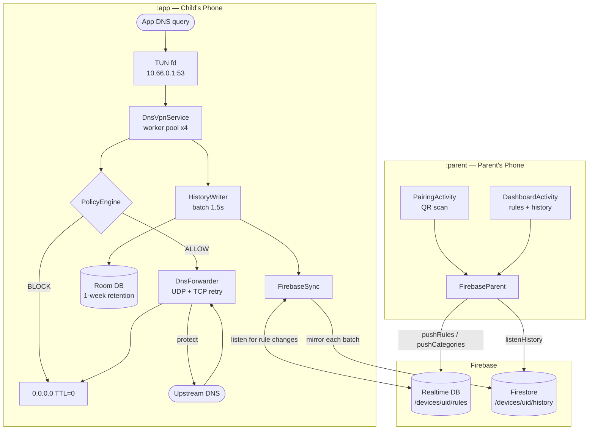
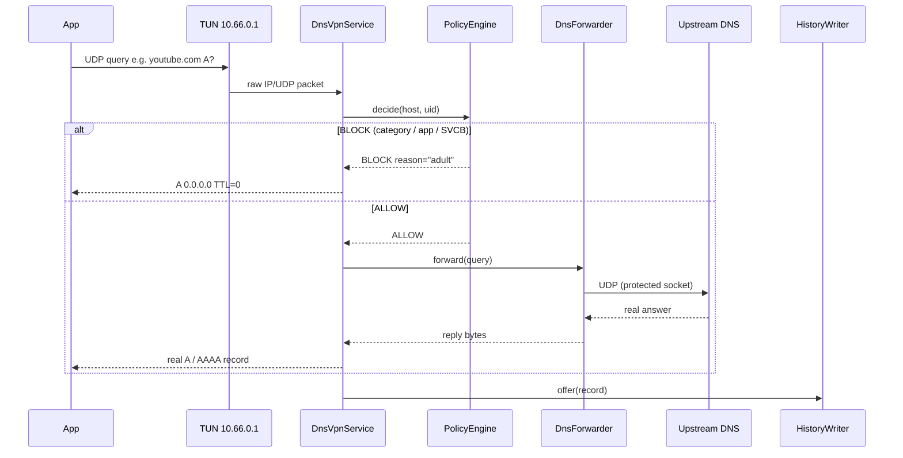

<div align="center">

# 🛡️ Tracewall

**On-device DNS filtering for Android — no root, no server, no account required.**

A local `VpnService` intercepts every DNS query on the child's phone, runs it
through a layered policy engine in microseconds, and shows the result live —
down to exactly which app asked for which name.  
Since **v2**, a companion parent app and Firebase backend let a parent push rules
and read history from any device, in real time.

[](https://openjdk.org/)
[-brightgreen?logo=android>)](https://developer.android.com/about/versions/nougat)
[](https://developer.android.com/build/releases/gradle-plugin)
[](https://junit.org/junit5/)
[](https://firebase.google.com/)
[](https://github.com/STARFALL088/Tracewall/releases/tag/v2)

</div>

---

## Table of Contents

- [What it does](#what-it-does)
- [Live demo](#live-demo-v1-verified-on-emulator-api-37)
- [Architecture](#architecture)
- [Versions](#versions)
- [Modules & code layout](#modules--code-layout)
- [How the tunnel works](#how-the-tunnel-works)
- [Rule precedence](#rule-precedence)
- [Parent sync — Firebase](#parent-sync--firebase)
- [Firebase setup](#firebase-setup)
- [Build](#build)
- [Status](#status)
- [Known gaps](#known-gaps)
- [Rule data](#rule-data)

---

## What it does

| Feature                   | Detail                                                                                            |
| ------------------------- | ------------------------------------------------------------------------------------------------- |
| **DNS-only VPN tunnel**   | Routes only `10.66.0.1/32` — one address — so a bug here can affect nothing but name resolution   |
| **Per-app attribution**   | Every query is tagged with the Android UID that sent it using `ConnectivityManager` socket tables |
| **Category blocking**     | Four built-in lists: `malware`, `gambling`, `adult`, `ads`                                        |
| **Per-app blocking**      | Block an entire app's DNS traffic from a long-press or the Apps screen                            |
| **Allowlist override**    | Explicit allows win over every category — long-press any blocked row                              |
| **Live query log**        | 500-entry in-memory ring, refreshed every 700 ms, with a custom trend bar chart                   |
| **Room history**          | Batched writes (1.5 s flush), one-week retention, exported via `ContentProvider`                  |
| **Remote rules (v2)**     | Parent pushes allow list, blocked UIDs and active categories from their phone via RTDB            |
| **Remote history (v2)**   | Every query is mirrored to Firestore; parent reads it live from the dashboard                     |
| **QR pairing (v2)**       | Child shows its UID and expiring one-time code as a QR code; parent scans it — no typing                            |
| **Private DNS warning**   | Banner appears when `Settings.Global.private_dns_mode` is non-`off`                               |
| **SVCB / HTTPS blocking** | Types 64 + 65 return NXDOMAIN immediately, closing the DoH auto-discovery path                    |
| **Bilingual**             | Full English and Bengali (`values-bn/`) string resources                                          |

---

## Live demo — v1, verified on emulator API 37

```
$ adb shell ping -c 1 example.com          # not in any list → forwarded
PING example.com (104.20.23.154)

$ adb shell ping -c 1 xvideos.com          # category: adult → sinkholed
PING xvideos.com (127.0.0.1)              # 0.0.0.0 written as loopback by ping

$ adb shell ping -c 1 pornhub.com          # same category, but long-pressed → Allow
PING pornhub.com (66.254.114.41)           # allowlist beats category, live

$ adb shell ping -c 1 _dns.resolver.arpa   # SVCB discovery (v2) → NXDOMAIN
ping: _dns.resolver.arpa: No address associated with hostname
```

The header read `Rules: 516` after the allowlist entry — the policy engine
reloaded in place without restarting the tunnel. Screenshots are in
`docs/screenshots/`.

---

## Architecture

### System overview



### DNS packet flow



---

## Versions

|                     | **v1**                                                           | **v2**                                                           |
| ------------------- | ---------------------------------------------------------------- | ---------------------------------------------------------------- |
| **Tag**             | [`v1`](https://github.com/STARFALL088/Tracewall/releases/tag/v1) | [`v2`](https://github.com/STARFALL088/Tracewall/releases/tag/v2) |
| **Date**            | 2026-10-20                                                       | 2026-10-26                                                       |
| **Modules**         | `blocklist`, `app`                                               | `blocklist`, `app`, `parent`                                     |
| **Network**         | None                                                             | Firebase (Auth, RTDB, Firestore)                                 |
| **Tests**           | 76                                                               | 77                                                               |
| **Device-verified** | ✅ Full                                                          | 🔄 Compiles; Firebase paths need real `google-services.json`     |

```bash
git checkout v1   # standalone filter — everything verified on device
git checkout v2   # full feature set — current HEAD
```

### What v2 added over v1

<details>
<summary><strong>Click to expand full changelog</strong></summary>

| Area                               | Change                                                                                                                                                                       |
| ---------------------------------- | ---------------------------------------------------------------------------------------------------------------------------------------------------------------------------- |
| **Firebase Auth**                  | `TracewallApp` signs in anonymously on startup; the UID identifies the device; pairing requires a separate one-time code                                                                          |
| **Realtime Database**              | `FirebaseSync.listenForRules()` subscribes to `/devices/{uid}/rules`; reloads `BlocklistStore` atomically on any parent write                                                |
| **Firestore**                      | `HistoryWriter` mirrors each batch to `/devices/{uid}/history` after the Room insert; Firestore SDK queues writes offline                                                    |
| **Offline persistence**            | Both databases enable on-disk caching before any reference is obtained                                                                                                       |
| **`:parent` module**               | Second Android app: `PairingActivity` (QR scan or manual entry), `DashboardActivity` (live history, allow/block/category controls)                                           |
| **Remote rules**                   | Parent-pushed allow list, blocked UIDs and category set stored under separate SharedPreferences keys and merged with local rules; parent never erases what child set locally |
| **Remote category toggle**         | Four switches in the parent dashboard; each change writes to `rules/categories` via `updateChildren` so it does not overwrite allow/block rules                              |
| **QR pairing**                     | Child: tap device-code label → 512×512 QR dialog (ZXing core); long-press → copy UID to clipboard. Parent: "Scan QR" button using `zxing-android-embedded` + `ScanContract`  |
| **Private DNS warning**            | Yellow banner in `MainActivity` when `Settings.Global.private_dns_mode ≠ off`; re-checked on every `onResume`                                                                |
| **SVCB / HTTPS blocking**          | `TYPE_SVCB=64`, `TYPE_HTTPS=65` added to `DnsMessage`; `DnsVpnService` returns NXDOMAIN before any policy check, closing the `_dns.resolver.arpa` DoH-discovery path         |
| **`AtomicBoolean`**                | `DnsVpnService.running` was `volatile boolean`; replaced with `AtomicBoolean` to remove the data-race between tunnel thread, `teardown()` and binder-thread `onDestroy()`    |
| **BootReceiver pre-warm**          | `FirebaseSync.signInAnonymously()` called at boot when protection was previously enabled                                                                                     |
| **Security rules**                 | `firebase/database.rules.json` + `firebase/firestore.rules` committed alongside the code; locked to `auth.uid` with parent-pairing carve-out                                 |
| **`google-services.json.example`** | Template committed in `app/` so contributors know what to fill in                                                                                                            |

</details>

---

## Modules & code layout

```
Tracewall/
├── blocklist/              Pure JVM — no android.* imports. Testable with just a JDK.
│   └── src/main/java/
│       ├── tracewall/net/
│       │   ├── DnsMessage.java       RFC 1035 wire codec: parse, build, compress, SVCB
│       │   ├── IpPacket.java         IPv4/IPv6 + UDP codec, real RFC 1071 checksums
│       │   └── DnsForwarder.java     Upstream UDP; TCP retry on TC=1; socket pool
│       └── tracewall/blocklist/
│           ├── DomainPattern.java    Exact + label-aligned wildcard matching
│           ├── DomainSet.java        HashSet (exact) + list (wildcards); O(1) exact lookup
│           ├── HostListParser.java   Hosts-format parser; counts malformed + duplicate
│           └── PolicyEngine.java     Immutable; precedence: allow > app > category > default
│
├── app/                    Child's phone. Needs Android SDK.
│   └── src/main/java/tracewall/child/
│       ├── TracewallApp.java         Application: Firebase sign-in + rules listener
│       ├── MainActivity.java         Toggle, live log, trend chart, Private DNS warning
│       ├── block/
│       │   └── BlocklistStore.java   Singleton rule store; atomic engine swap on reload
│       ├── log/
│       │   ├── HistoryWriter.java    Batched Room writer + Firestore mirror
│       │   ├── QueryLog.java         500-entry in-memory ring for the live UI
│       │   ├── QueryRecord.java      Room @Entity
│       │   ├── QueryDao.java         Room DAO: insertAll, prune
│       │   ├── TracewallDb.java      Room database, WAL mode
│       │   └── QueryLogProvider.java Read-only ContentProvider (exported=false)
│       ├── sync/
│       │   └── FirebaseSync.java     Facade: Auth, RTDB rules listener, Firestore logQuery
│       ├── ui/
│       │   ├── AppBlockActivity.java Per-app blocking list with search
│       │   ├── AppBlockAdapter.java  RecyclerView adapter, toggle per app
│       │   ├── QueryAdapter.java     History rows; long-press → allow / block app
│       │   ├── TrendView.java        Custom View: buckets queries into 1-min bars
│       │   └── Notifications.java   "Protection is off" notification
│       ├── vpn/
│       │   ├── DnsVpnService.java    TUN loop, worker pool, SVCB blocking
│       │   └── UidAttributor.java    Maps (srcIp, srcPort) → Android UID
│       └── boot/
│           └── BootReceiver.java     BOOT_COMPLETED: notify + pre-warm Firebase
│
├── parent/                 Parent's phone. Second APK, same Firebase project.
│   └── src/main/java/tracewall/parent/
│       ├── TracewallParentApp.java   Application: anonymous Firebase sign-in
│       ├── PairingActivity.java      Enter child UID or scan QR; registerAsParent
│       ├── DashboardActivity.java    Live history + allow/block/category rule forms
│       └── sync/
│           └── FirebaseParent.java   registerAsParent, pushRules, pushCategories, listenHistory
│
└── firebase/               Security rules — deploy with Firebase CLI.
    ├── database.rules.json           RTDB: auth.uid === $uid || parent lookup
    └── firestore.rules               Firestore: same + /devices/{uid}/parents/{parentUid}
```

**Why the split?** The hardest code — wire formats, real checksums — lives in
`blocklist/` with zero Android dependencies. `./gradlew :blocklist:test` runs all
77 tests on any laptop with just a JDK, including checksum re-verification
against an independent RFC 1071 reference and 11 policy-precedence tests.
No emulator needed.

---

## How the tunnel works

```
Device address   10.66.0.2/24
Advertised DNS   10.66.0.1
Routed           10.66.0.1/32 only    ← one address, nothing else enters the tunnel
```

Only packets destined for `10.66.0.1:53` enter the TUN file descriptor. A bug
here can sink DNS; it cannot route arbitrary traffic or MITM HTTPS.

**Packet handling (per-query, on a worker thread):**

1. `IpPacket.parse()` decodes the outer IPv4 or IPv6/UDP header.
2. `DnsMessage.parse()` decodes the DNS question. Non-DNS or malformed → dropped.
3. `TYPE_SVCB` / `TYPE_HTTPS` (64/65) → **NXDOMAIN** immediately.
   This kills the `_dns.resolver.arpa` auto-discovery that would let the OS find
   a DoH/DoT server to route around the filter.
4. `PolicyEngine.decide(host, uid)` evaluates the query (see precedence below).
5. **Block** → A queries receive `0.0.0.0` with TTL 0; other policy-blocked
   types receive NOERROR with zero answers, preserving the question type.
6. **Allow** → `DnsForwarder.forward()` sends the query on a `protect()`-ed
   socket. Without `protect()` the forwarder's own queries go back into the
   tunnel and loop until file descriptors run out.
7. The reply is rebuilt with correct IPv4 header and UDP checksums.
   Android does not fix those up on a TUN write; a bad checksum means the
   client silently discards the answer with no visible error.
8. `HistoryWriter.offer(record)` hands the entry to the 1.5 s batch loop.

The service follows the default network via `ConnectivityManager.NetworkCallback`,
so a Wi-Fi → mobile handover rebuilds the forwarder socket pool instead of
leaving every lookup to time out.

---

## Rule precedence

```
  ┌───────────────────────────────────────────────────┐
  │  1. Explicit ALLOW  (exact or wildcard)           │  ← wins over everything below
  │     Long-press a blocked row  –or–  parent push   │
  ├───────────────────────────────────────────────────┤
  │  2. Per-app BLOCK  (whole Android UID)            │  ← beats categories
  │     AppBlockActivity toggle  –or–  parent push    │
  ├───────────────────────────────────────────────────┤
  │  3. Category BLOCK  (malware / gambling /         │  ← beats default
  │     adult / ads)   parent can toggle each live    │
  ├───────────────────────────────────────────────────┤
  │  4. Default ALLOW                                 │
  └───────────────────────────────────────────────────┘
```

Categories are loaded into a `TreeMap` so when a host appears in two of them it
always reports the alphabetically-first reason — deterministic across restarts and
devices.

**Rule merging (v2).** Local rules (set on the child's device) and remote rules
(pushed by the parent) are merged before the `PolicyEngine` is built:

- **Allow list** and **blocked UIDs** → union of local + remote. The parent can
  add entries without erasing anything the child set locally, and vice versa.
- **Active categories** → remote **replaces** local when the parent has set them;
  otherwise the device default (all four) applies. This lets the parent switch
  off `ads` without the child being able to re-enable `adult`.

---

## Parent sync — Firebase

Realtime Database carries rules (low latency, parent → child).
Firestore carries history (queryable, child → parent).

### Data schema

```
Realtime Database
└── devices/
    └── {childUid}/
        ├── rules/
        │   ├── allow/           {0: "example.com", 1: "*.safe.org", ...}
        │   ├── blocked_uids/    {0: 10123, 1: 10456, ...}
        │   └── categories/      {malware: true, gambling: true, adult: true, ads: false}
        ├── pairing/       {code, expires_ms, claimed_by?}
        └── parentUid/
            └── {parentUid}: "ABCDEFGH"         ← code used for registration

Firestore
└── devices/
    └── {childUid}/
        ├── history/
        │   └── {auto-id}        {time_ms, host, blocked, app_uid, policy}
        ├── events/{auto-id}  {type: "protection_off", reason, time_ms}
        │                    or {type: "new_app", label, package, time_ms}
        ├── pairing/current  {code, expires_ms, claimed_by?}
        └── parents/
            └── {parentUid}: {code: "ABCDEFGH"} ← independently validated membership
```

### Pairing flow

```mermaid
sequenceDiagram
    participant Child as Child App
    participant FB    as Firebase
    participant Parent as Parent App

    Child  ->> FB    : signInAnonymously() → childUid
    Child  ->> Child : generate code + expiry; show QR(uid, code)
    Parent ->> FB    : signInAnonymously() → parentUid
    Parent ->> Child : scan QR → get childUid + code
    Parent ->> FB    : RTDB atomic registration(code) + pairing claim
    Parent ->> FB    : Firestore batch registration(code) + pairing claim
    Child  ->> FB    : clear pairing records after both claims match
    FB     -->> Child : rules snapshot fires → BlocklistStore.applyRemoteRules()
    Child  -->> FB    : HistoryWriter mirrors each batch → Firestore history
    Parent ->> FB    : listenHistory() → live Firestore snapshot
```

### Security model — honestly

Anonymous Firebase Auth identifies each child and parent. Knowing a child UID
alone grants no access. A parent must claim a random eight-character code within
five minutes. The code and expiry live at RTDB `devices/{uid}/pairing` and
Firestore `devices/{uid}/pairing/current`; neither is readable by other users.
Registration atomically writes membership plus `claimed_by` in each database,
which prevents a second claim even before the child clears the pairing records.
Codes are generated with `SecureRandom` (40 bits). QR payloads contain
`tracewall:1:{childUid}:{code}`; manual entry requires both UID and code.

Only registered parents can write RTDB rules; the child can read its rules.
Only the child writes history and events. Registered parents can read those
collections but cannot modify or delete them. There are no broad device-level
read/write grants. The child can revoke membership; the app queues deletion in
both databases and mirrors RTDB removals observed while running. New pairing and
revocation actions on the child require the local parent PIN.

**Limits:** Firestore cannot check RTDB membership. Registration and revocation
across the two databases are not atomic. A partial failure can leave membership
in only one database; revoke it on the child and generate a new code before
retrying. A party who steals a live code can race its intended recipient,
including claiming one database before the other; there is no trusted server to
coordinate them. Out-of-band RTDB deletion while the child is not listening must
also delete the Firestore membership. There is no server-side pairing attempt
rate limit or durable parent account recovery. Anonymous identities are lost if
app data is cleared. Firebase rules do not prevent uninstall, system VPN changes,
Private DNS/DoH bypass, or tampering on a rooted device. Local PIN storage uses
salted PBKDF2; its attempt lockout relies on the device clock and app storage.

Rules in `firebase/` protect deployed projects **only after deployment**. Run the
credential-free emulator regression suite before deploying:

```bash
firebase emulators:exec --config firebase/firebase.json --project demo-tracewall \
  --only auth,database,firestore 'node firebase/test_rules.mjs'
firebase deploy --config firebase/firebase.json --project YOUR_PROJECT --only database,firestore:rules
```


---

## Firebase setup

> Skip this entirely if you only want to run the local filter (v1 behaviour).
> Firebase is optional; every DNS decision still happens on-device.

**1. Create a project**

- [console.firebase.google.com](https://console.firebase.google.com) → New project
- Enable **Anonymous** sign-in (Authentication → Sign-in method)
- Create a **Realtime Database** (start in locked mode)
- Create a **Firestore** database (start in production mode)

**2. Add Android apps**

Add two Android apps to the project:

| App              | Package name       | Config file destination       |
| ---------------- | ------------------ | ----------------------------- |
| Tracewall Child  | `tracewall.child`  | `app/google-services.json`    |
| Tracewall Parent | `tracewall.parent` | `parent/google-services.json` |

Both files are gitignored. The committed copies are placeholders;
`app/google-services.json.example` shows the required shape.
**Every Firebase call fails at runtime until these are replaced.**

**3. Deploy security rules**

```bash
npm install -g firebase-tools
firebase login
firebase init   # select your project; choose Realtime Database + Firestore
firebase deploy --only database,firestore:rules
```

The rules are already written in `firebase/`; the `firebase init` step just
creates the local config pointing at your project.

---

## Build

**Prerequisites:** JDK 17 (pinned in `gradle.properties`), Android SDK with
`compileSdk 34`. Gradle 8.9 is pinned in the wrapper — AGP 8.5 is incompatible
with both JDK 27 and Gradle 9, and both failures are opaque.

```bash
# Run the pure-JVM engine tests (no emulator, no SDK needed)
./gradlew :blocklist:test

# Build the child APK
./gradlew :app:assembleDebug
# → app/build/outputs/apk/debug/app-debug.apk

# Build the parent APK
./gradlew :parent:assembleDebug
# → parent/build/outputs/apk/debug/parent-debug.apk

# Install child on a connected device / emulator
adb install -r app/build/outputs/apk/debug/app-debug.apk

# Regenerate the malware blocklist from abuse.ch URLhaus
./scripts/fetch-malware-list.sh
```

---

## Status

| Feature                                        | Status                   | Notes                                    |
| ---------------------------------------------- | ------------------------ | ---------------------------------------- |
| Lifecycle logs + restored filters and scroll  | DONE — JVM + APK builds | Rotation code reviewed; device check blocked by emulator disk space |
| New install notifications + parent feed        | DONE — JVM + APK builds | Dynamic package receiver, ignores updates; Firestore event rules tested |
| Daily WorkManager refresh                    | DONE — APK builds       | Unique connected 24-hour work; exponential retry; last result shown |
| HTTPS refresh + JSON backups                  | DONE — JVM + APK builds | Bounded HTTPS, atomic files, validated PIN-gated local backups |
| Larger licensed category lists                | DONE — JVM + APK builds | ~95k merged entries; 2.43 MB total assets; load time logged |
| One-time pairing + scoped Firebase rules       | DONE — builds + emulator tested | Expiry, atomic claims per database, PIN-gated revocation |
| Parent rule list editing                      | 🔄 Compiles + JVM tested | Full snapshot before edits, preserves lists, removal UI |
| Parent tamper banner + last seen              | 🔄 Compiles              | Latest off event, persistent dismissal; newest DNS history time |
| Parent PIN + tamper events                    | 🔄 Compiles + JVM tested | Salted PBKDF2, 5 attempts / 30 s lockout; Firestore off events |
| Always-on VPN guidance                        | DONE — APK builds       | VPN settings with general-settings fallback; device check pending |
| Upstream handover                             | 🔄 Compiles + JVM tested | Volatile snapshot, one retry on closed pool |
| Blocked non-A responses                       | ✅ JVM tested             | NOERROR, zero answers; question preserved |
| DNS interception (VpnService)                  | ✅ Verified on device    | Emulator API 37                          |
| Category blocking (malware/gambling/adult/ads) | ✅ Verified              | 4 built-in lists, hot-reload             |
| Per-app attribution                            | ✅ Verified              | `ConnectivityManager` UID lookup         |
| Per-app blocking (list screen)                 | ✅ Verified              | `AppBlockActivity`, toggle per app       |
| Allowlist override                             | ✅ Verified              | Long-press any blocked row               |
| Live query log                                 | ✅ Verified              | 500-entry ring, 700 ms refresh           |
| Custom trend bar chart                         | ✅ Verified              | 1-min buckets, `TrendView` custom view   |
| Room history + ContentProvider                 | ✅ Verified              | 1.5 s batch, 1-week retention            |
| CSV export                                     | DONE — JVM + APK builds | PIN-gated FileProvider CSV; ACTION_SEND chooser |
| Bilingual (English + Bengali)                  | ✅ Verified              | `values-bn/`                             |
| Boot notification                              | ✅ Verified              | `BootReceiver`                           |
| SVCB / HTTPS type blocking                     | ✅ Compiled, 77/77 tests | Closes DoH discovery path                |
| Private DNS warning banner                     | ✅ Compiled              | Reads `Settings.Global` on resume        |
| Firebase Auth (anonymous)                      | 🔄 Compiles              | Needs real `google-services.json`        |
| Realtime Database rules listener               | 🔄 Compiles              | Needs real `google-services.json`        |
| Firestore history mirror                       | 🔄 Compiles              | Needs real `google-services.json`        |
| Remote category toggles                        | 🔄 Compiles              | RTDB `rules/categories`                  |
| QR pairing — child (generate)                  | 🔄 Compiles              | ZXing core, tap device-code label        |
| QR pairing — parent (scan)                     | 🔄 Compiles              | `zxing-android-embedded`, `ScanContract` |
| Parent app — pairing screen                    | 🔄 Compiles              | `PairingActivity`                        |
| Parent app — dashboard / rules                 | 🔄 Compiles              | `DashboardActivity`                      |
| Parent app — live history                      | 🔄 Compiles              | Firestore snapshot listener              |

**Key:** ✅ Device-verified &nbsp;|&nbsp; 🔄 Compiles, not yet on device &nbsp;|&nbsp; ⚠️ Known gap

---

While `DnsVpnService` exists, a dynamic `ACTION_PACKAGE_ADDED` receiver (package
scheme) ignores `EXTRA_REPLACING` updates. It resolves the label off the main
thread, posts a local notification linking to the Apps screen, and writes a
`new_app` Firestore event with label, package and installation time. The receiver
is unregistered in `onDestroy`. The parent merges the latest 50 DNS records and
50 device events in time order, retaining the most recent protection-off banner
within that event window. Notification permission denial does not prevent the
Firebase event. Installs while the VPN service is absent are not observed.


### Lifecycle

`MainActivity` and `AppBlockActivity` log `onCreate`, `onStart`, `onResume`,
`onPause`, `onStop`, `onRestart`, and `onDestroy` with tag `TracewallLifecycle`.
Both save their visible search text and RecyclerView layout state; the Apps
screen waits until its asynchronous scan fills the adapter before restoring
scroll. Main also restores its controls scroll position. Its ticker runs only
while resumed. The VPN switch is excluded from framework view-state saving,
and restoration suppresses its listener. Activity lifecycle callbacks never
start or stop the VPN: only user actions or the VPN-consent result do so.
The process query ring is retained when reopening the Activity; Room survives
process death, but the live ring does not. Rotation still needs a device check:
no ADB device was connected, and the API 37 AVD could not start with only 1.4 GB
free host disk space. Verify both filters/scroll offsets and confirm a single
`tunnel up` log while DNS continues through rotation.


## Known gaps

These are honest, not excuses — the filter works correctly for everything in ✅ above.

- **Parent-side UID entry has no app picker.** The dashboard takes a raw
  Android UID to block. The parent app cannot see the child's installed app list
  (it is on a different device), so there is no friendly name-to-UID resolver.

- **No Firestore retention.** The Firestore history collection grows unboundedly.
  The on-device Room database prunes rows older than one week; the Firestore
  mirror has no equivalent TTL or Cloud Function cleanup job.

- **Pairing spans two databases.** Claims and revocations cannot be atomic
  across RTDB and Firestore. See the Security model for recovery and live-code
  theft limits. Multiple parents editing rules simultaneously still use last-write-wins.

- **NXDOMAIN for HTTPS (type 65) is a blunt instrument.** It also blocks the
  `HTTPS` record optimisation that CDNs use to advertise QUIC / HTTP/3. Clients
  fall back to plain A/AAAA and still work, but the first-hop latency hint is
  lost.

- **UDP DNS only; IPv4 tunnel only.** No DNS-over-TLS upstream (the filter itself
  sees all queries in plaintext regardless — it intercepts before encryption).

- **Private DNS is warned, not disabled.** A determined user can keep Private DNS
  on. The new **Make it permanent** button explains always-on VPN and
  lockdown, then opens Android VPN settings; this still needs device testing.

- **Tamper reporting is best effort.** Android may kill or force-stop a process
  without a lifecycle callback. Events cannot be guaranteed in that case; anonymous
  Firebase sign-in must have succeeded for offline event queueing. A local PIN
  cannot prevent uninstall, clearing app data, or changing system settings.

- **VPN cannot self-restart after a reboot.** `BootReceiver` posts a notification
  instead; always-on VPN is the system-supported solution.

---

## Rule data

`app/src/main/assets/categories/` — one hosts-format file per category:

| File | Entries | Source URL | License |
| --- | ---: | --- | --- |
| `malware.txt` | ~420 | [abuse.ch URLhaus](https://urlhaus.abuse.ch/downloads/hostfile/) (existing snapshot) | URLhaus terms; existing data, not refreshed by this script |
| `adult.txt` | 60,020 | [Block List Project porn hosts](https://raw.githubusercontent.com/blocklistproject/Lists/master/porn.txt) | [Unlicense](https://github.com/blocklistproject/Lists/blob/master/LICENSE) |
| `gambling.txt` | 15,020 | [Block List Project gambling hosts](https://raw.githubusercontent.com/blocklistproject/Lists/master/gambling.txt) | [Unlicense](https://github.com/blocklistproject/Lists/blob/master/LICENSE) |
| `ads.txt` | 20,049 | [Block List Project ads hosts](https://raw.githubusercontent.com/blocklistproject/Lists/master/ads.txt) | [Unlicense](https://github.com/blocklistproject/Lists/blob/master/LICENSE) |

Run `scripts/fetch-lists.sh` (curl + Python 3) to download, normalize, sort,
deduplicate and merge these sources with the bundled entries. The script takes
a bounded alphabetical subset (60k adult / 15k gambling / 20k ads) to keep all
assets below 5 MB; this is deliberately incomplete coverage. The current total
is 2,428,709 bytes. Source URLs and license links are also embedded in each file.
Regeneration aborts before replacing assets if downloads or the size budget fail.
`BlocklistStore` logs elapsed load time, malformed entries and duplicates in Logcat.

In-app **Update lists** uses smaller refresh feeds, merged with the bundled
baseline rather than the oversized full Block List Project downloads:

| Category | Refresh URL | License / attribution |
| --- | --- | --- |
| adult | [Tiuxo porn](https://raw.githubusercontent.com/tiuxo/hosts/master/porn) | Tiuxo, [CC BY 4.0](https://github.com/tiuxo/hosts/blob/master/LICENSE); normalized and merged |
| ads | [Tiuxo ads](https://raw.githubusercontent.com/tiuxo/hosts/master/ads) | Tiuxo, CC BY 4.0; normalized and merged |
| gambling | [hostsVN Gambling VN](https://raw.githubusercontent.com/bigdargon/hostsVN/master/extensions/gambling/hosts-VN) | BigDargon, [MIT](https://github.com/bigdargon/hostsVN/blob/master/LICENSE); normalized and merged |
| malware | [URLhaus hostfile](https://urlhaus.abuse.ch/downloads/hostfile/) | abuse.ch URLhaus, CC0; availability subject to upstream access policy |

Refresh uses `HttpURLConnection` off the main thread, HTTPS-only redirects (up
to three), 15-second connection / 20-second read timeouts, strict UTF-8, a 5 MB
cap on each response and merged file, at least 100 unique downloaded entries,
and zero malformed entries. Each valid category is synced to a temporary file
and atomically replaced in `filesDir/lists/`; failed categories retain their
previous file, or bundled asset. The policy reloads without restarting the VPN.
The UI reports successful/failed categories, newly added rules, last attempt,
and last fully successful update. Retaining the bundled baseline means domains
removed upstream may remain blocked until a new APK baseline is shipped.

`ListRefreshWorker` (WorkManager 2.9.1) schedules unique periodic work named
`tracewall.category-refresh.v1` with `KEEP`, a 24-hour interval and initial delay,
`NetworkType.CONNECTED`, and exponential backoff starting at 30 minutes. It is
scheduled when protection is enabled, restored at application startup if still
enabled, and cancelled when protection is disabled. Android may defer execution.
It calls the same updater; any failed category returns `retry()`. The previous
lists and VPN continue operating. Manual and worker updates serialize through a
shared lock, and the UI shows the persisted result from either path.

PIN-gated **Export rules** / **Import rules** share JSON via FileProvider and
select JSON with `ACTION_OPEN_DOCUMENT`. Version 1 contains only `version`,
`allow`, `blocked_uids`, and all four boolean `categories`. Unknown/missing fields,
invalid types/domains/UIDs, more than 1,000 entries per list, and files over
256,000 bytes are rejected before applying. Import replaces local rules in one
preferences edit; remote parent rules retain their precedence. No PIN, pairing
secret, browsing history or remote membership is included.

Each file is parsed by `HostListParser` into a `DomainSet` (exact hosts into a
`HashSet`, wildcards into a small scanned list). A 200k-domain list stays cheap
because exact lookup is O(1) and wildcards are rare in practice.

---

<div align="center">

Built for the **Advanced Programming Laboratory** Android project · Dhaka, 2026

</div>
