<div align="center">

# 🛡️ Tracewall

**On-device DNS filtering for Android — no root, server, or account required.**

[](https://github.com/STARFALL088/Tracewall/actions/workflows/ci.yml)
[](https://openjdk.org/)
[](https://developer.android.com/about/versions/nougat)
[](https://github.com/STARFALL088/Tracewall/releases/tag/v2.2.0)
[](https://github.com/STARFALL088/Tracewall/tree/v2.3.0-dev.1)
[](docs/location-sharing.md#verification)

</div>

Tracewall is a Java Android project with two apps:

- **Child:** a local `VpnService` intercepts ordinary DNS, applies rules on the
  device, and records activity in Room.
- **Parent:** an optional companion app pairs through Firebase to manage rules
  and view consented activity.

Local filtering works without Firebase. Cloud sync, shared history, app names,
and location are separate opt-in features.

> **Release status:** `v2.2.0` is the latest stable release. The current branch
> is the `2.3.0-dev.1` preview and adds visible, latest-point-only location
> sharing. It is not a stable release.

## Highlights

| Feature | What it provides |
| --- | --- |
| Narrow VPN route | Routes only `10.66.0.1/32`, so Tracewall handles DNS rather than general device traffic |
| Layered policy | Parent-managed rules, local allows/denies, app UID blocks, schedules, and four built-in categories |
| DNS visibility | Best-effort app attribution, live activity, retained Room history, search, statistics, and CSV export |
| Resilient lists | Bundled malware, gambling, adult, and ad lists with bounded HTTPS refresh and health reporting |
| Parent controls | Expiring QR/manual pairing, remote rules, history, saved child profiles, and revocation |
| Privacy controls | Local mode by default; PIN-gated cloud consent, retention, deletion, exports, and sensitive settings |
| Location preview | Explicit PIN and permission flow, visible foreground service, one latest point, and no route history |
| Android UX | English and Bengali interfaces, diagnostics, notifications, and Private DNS guidance |

## Screenshots

Captured from `v2.2.0` on Android 13. The parent dashboard used temporary local
sample state; no private account, membership, or DNS history was published.

### Child app

| Home | Activity | Protect |
| :--: | :------: | :-----: |
| [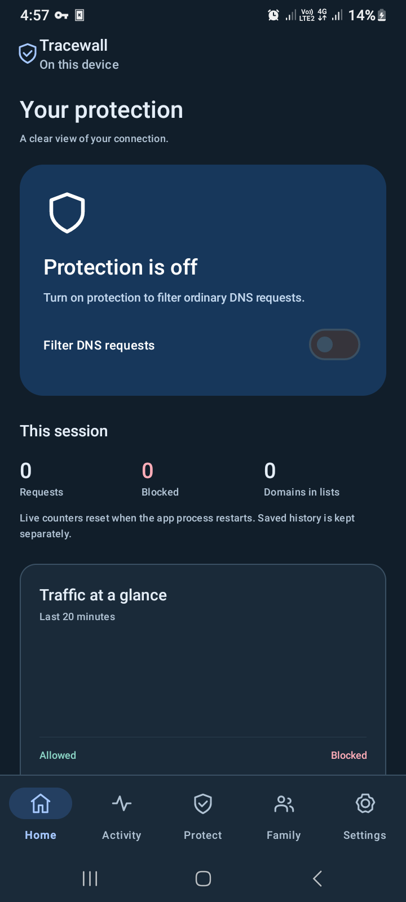](docs/screenshots/03-child-home.png) | [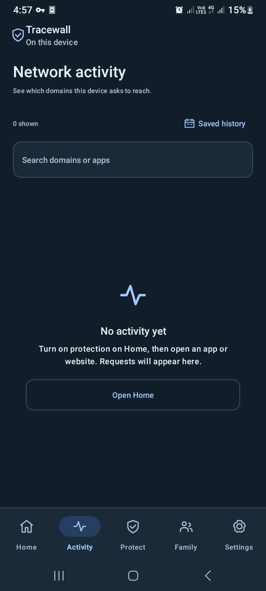](docs/screenshots/04-child-activity.png) | [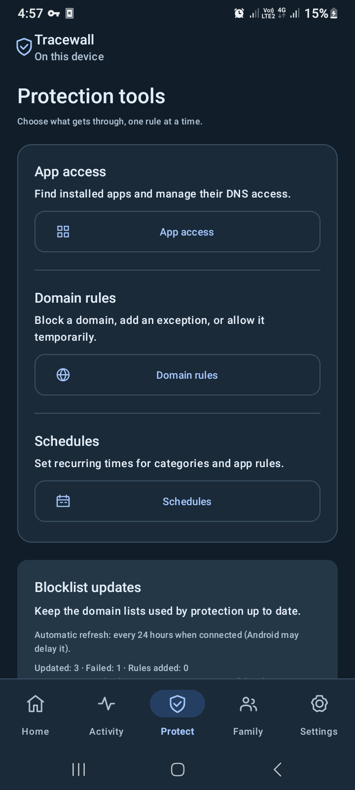](docs/screenshots/05-child-protect.png) |

| Family | Settings |
| :----: | :------: |
| [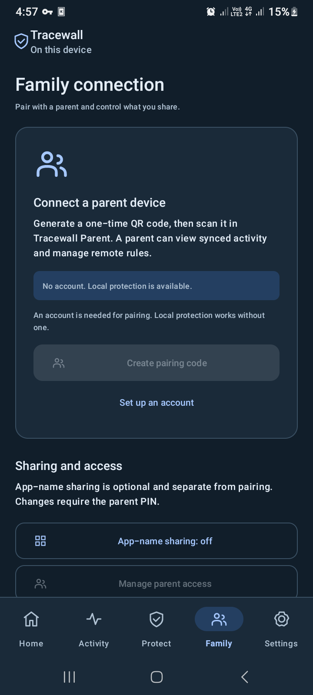](docs/screenshots/06-child-family.png) | [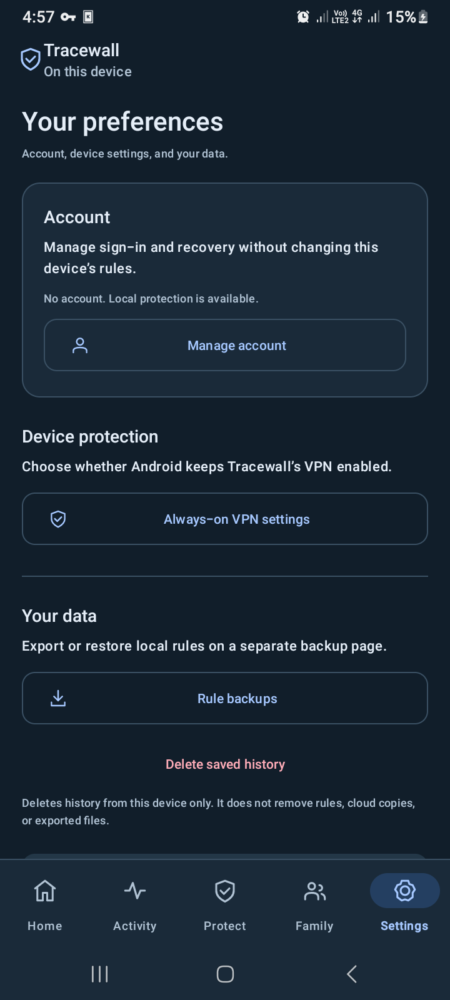](docs/screenshots/07-child-settings.png) |

### Parent app

| Pairing | Overview | Activity |
| :-----: | :------: | :------: |
| [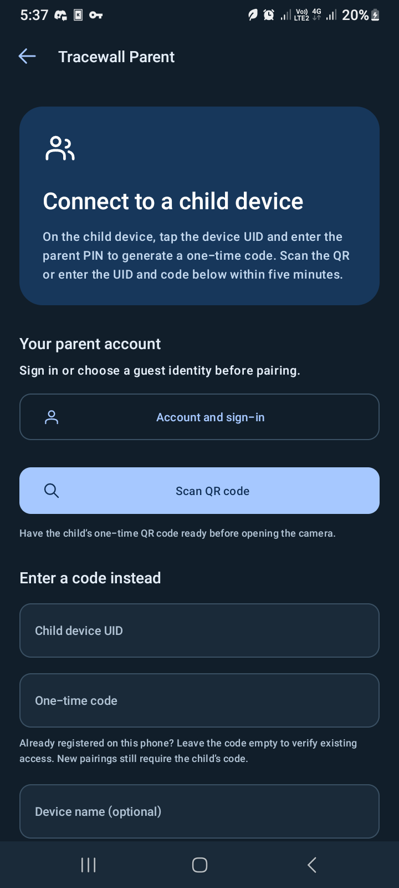](docs/screenshots/08-parent-pairing.png) | [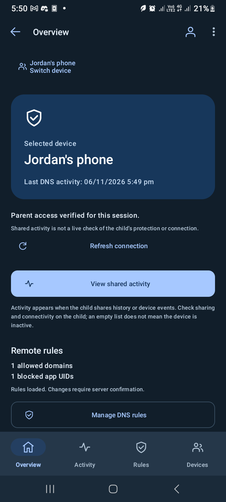](docs/screenshots/09-parent-overview.png) | [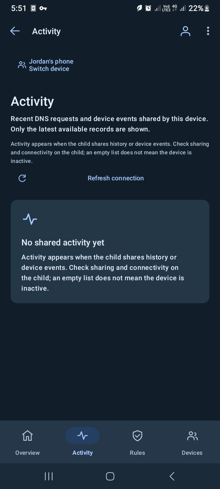](docs/screenshots/10-parent-activity.png) |

| Rules | Devices |
| :---: | :-----: |
| [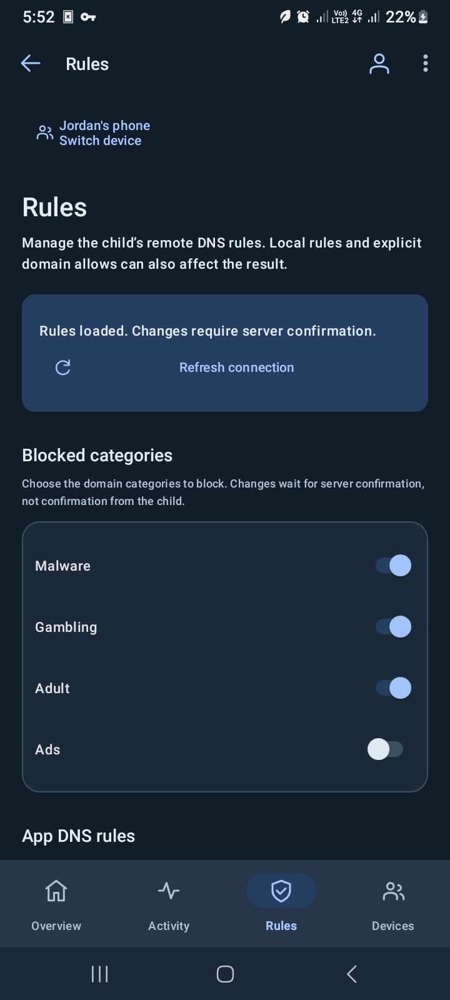](docs/screenshots/11-parent-rules.png) | [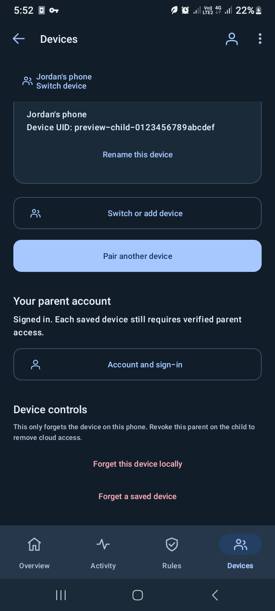](docs/screenshots/12-parent-devices.png) |

## How it works

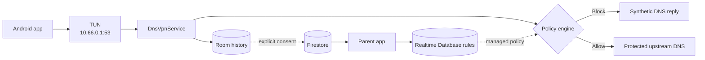

For each intercepted query, Tracewall parses the packet, evaluates an immutable
policy snapshot, and either returns a synthetic blocked response or forwards the
query through a VPN-protected socket. Policy swaps do not restart the tunnel.

### Rule order

1. **Managed parent policy:** parent allows, app blocks, and categories. Any
   non-default managed decision is authoritative.
2. **Local allow:** permanent or unexpired temporary patterns.
3. **Local deny:** exact or wildcard patterns.
4. **App block:** base rules plus active weekly profiles.
5. **Category block:** base rules plus active weekly profiles.
6. **Default allow.**

This means a local rule cannot weaken a parent block, while a parent allow can
override a local deny. See [rules and schedules](docs/rules-schedules.md) for the
full matching, expiry, backup, and time-zone semantics.

## Project layout

| Path | Purpose |
| --- | --- |
| `blocklist/` | Pure-Java DNS/IP codecs, forwarding, hosts parsing, and policy engine |
| `auth/` | Shared Android authentication UI and immutable-identity safeguards |
| `app/` | Child APK: VPN, Room, rules, privacy controls, and optional sharing |
| `parent/` | Parent APK: pairing, remote controls, activity, devices, and preview map |
| `firebase/` | Realtime Database and Firestore rules plus emulator tests |
| `docs/` | Design notes, security limits, verification records, and project report |

The project uses Java 17 throughout; Kotlin is not used in application code.

## Build

### Requirements

- JDK 17
- Android SDK 34 with Build Tools 34.0.0
- The checked-in Gradle 8.9 wrapper

```bash
# Run all regular JVM and Robolectric tests
./gradlew :blocklist:test :auth:testDebugUnitTest \
  :app:testDebugUnitTest :parent:testDebugUnitTest

# Build both debug APKs
./gradlew :app:assembleDebug :parent:assembleDebug

# Optional static checks
./gradlew :auth:lintDebug :app:lintDebug :parent:lintDebug
```

APK outputs:

```text
app/build/outputs/apk/debug/app-debug.apk
parent/build/outputs/apk/debug/parent-debug.apk
```

## Optional Firebase setup

Firebase is not needed for local DNS filtering. To enable parent features:

1. Create a Firebase project and enable **Email/Password** authentication.
   Enable Anonymous authentication only if explicit guest sessions are wanted.
2. Register Android apps named `tracewall.child` and `tracewall.parent`.
3. Supply each app's `google-services.json` through your normal private
   configuration process.
4. Test the checked-in rules against the local emulators before deploying them.

```bash
bash scripts/test-firebase-rules.sh

firebase deploy --config firebase/firebase.json --project YOUR_PROJECT \
  --only database,firestore:rules
```

Pairing uses an expiring one-time code in addition to the child UID. Realtime
Database carries managed rules; Firestore carries consented history, events,
app metadata, memberships, and the optional latest location.

## Privacy and security boundaries

- Filtering and list decisions happen locally, including when cloud mode is off.
- Startup never creates an anonymous identity. Cloud access requires an explicit
  account or guest action, a bound identity, and the relevant consent.
- Sensitive child actions are protected by the local parent PIN.
- Location preview requires a PIN, Android permissions, and a visible foreground
  notification. It overwrites one point and does not create a route history.
- Registered parents can read consented child data and manage rules, but cannot
  write child history or location.
- Firebase rules protect a project only after they are tested and deployed.

## Known limits

- Tracewall filters intercepted DNS, not all network traffic. App-owned DoH,
  direct IP connections, alternate resolvers, and cached answers can bypass it.
- The tunnel currently targets ordinary UDP DNS through an IPv4 route; it is not
  a general firewall or HTTPS man-in-the-middle.
- Private DNS is detected and explained, but Tracewall cannot disable it.
- Pairing and revocation span Realtime Database and Firestore, so they cannot be
  one cross-database transaction.
- A local PIN cannot prevent uninstalling, clearing app data, changing Android
  VPN settings, or tampering on a rooted device.
- The preview map uses the final osmdroid release; upstream was archived in 2024,
  so migration to a maintained renderer remains future work.

## Verification

The current preview branch records:

- **306 JVM/Robolectric tests:** 237 core, 11 child, 6 parent, and 52 auth
- **22 Python contract tests**
- **128 Firebase emulator checks**
- Both debug APKs assembled and all three lint tasks completed with zero errors
- A physical child-to-parent latest-location round trip verified on Android 13

These results do not imply every workflow has been tested on every supported
Android version. Detailed evidence and pending device checks remain in `docs/`.

## Documentation

| Document | Contents |
| --- | --- |
| [Project report](docs/REPORT.md) | Architecture, decisions, tests, limitations, and future work |
| [Authentication](docs/authentication.md) | Account setup, immutable identity, recovery, and restrictions |
| [Privacy controls](docs/privacy-controls.md) | Consent, retention, local mode, and cloud deletion |
| [Rules and schedules](docs/rules-schedules.md) | Policy precedence, custom rules, timers, profiles, and backups |
| [List health](docs/list-health.md) | Feed validation, refresh behavior, and bundled-seed policy |
| [Location sharing](docs/location-sharing.md) | Preview consent flow, access rules, implementation, and verification |
| [Syllabus coverage](docs/SYLLABUS_COVERAGE.md) | Course requirements and implementation mapping |

## Rule data and attribution

Bundled category files live in `app/src/main/assets/categories/`. They are built
from [urlhaus-filter](https://gitlab.com/malware-filter/urlhaus-filter)
(GPL-3.0 filter; URLhaus data CC0) and the
[Block List Project](https://github.com/blocklistproject/Lists) (Unlicense).
Smaller refresh feeds also use [Tiuxo hosts](https://github.com/tiuxo/hosts)
(CC BY 4.0) and [hostsVN](https://github.com/bigdargon/hostsVN) (MIT).
Source and license references are embedded in the generated files.

```bash
./scripts/fetch-lists.sh
```

The generator downloads, normalizes, sorts, deduplicates, validates, and enforces
the repository's size limits before replacing any bundled list.

---

<div align="center">

Built for the **Advanced Programming Laboratory** Android project · Dhaka, 2026

</div>
