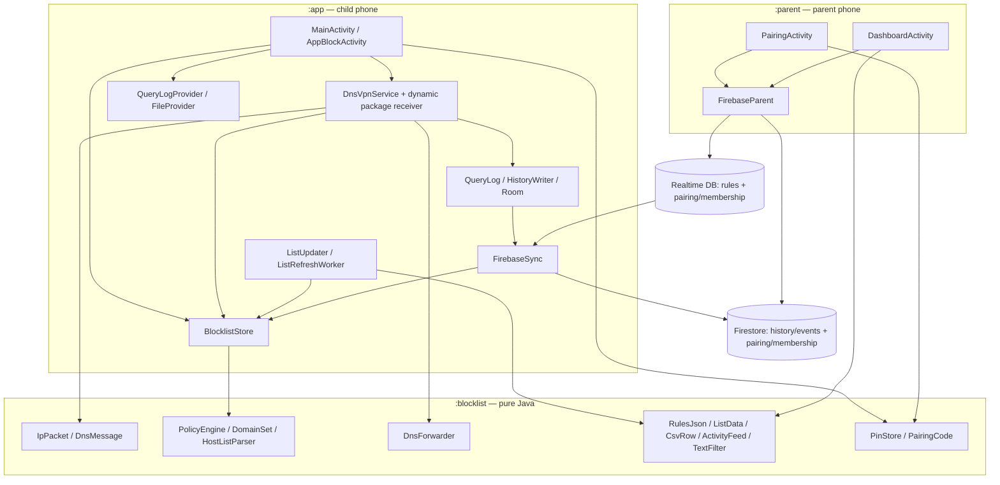

# Tracewall — Week 13 project report

Date: 29 October 2026. Java 17, Android minSdk 24 / compileSdk 34 / targetSdk 34.
This report describes the implementation at the end of tasks A–H. A successful
build is distinguished from device testing and production Firebase verification.

## Problem statement

Families need a visible, understandable way to filter ordinary DNS requests on
an Android phone and review the resulting decisions. Tracewall offers local
category and app-based DNS filtering, a live log, durable local history, and an
optional parent companion for remote rules and activity. It requires no root.
It is a teaching project and a cooperative parental-control tool; Android system
settings, encrypted DNS and uninstall remain outside its enforcement boundary.

## Architecture



Both Android modules depend on `:blocklist`; neither Android module depends on
the other. `firebase/` contains the deployable security rules and emulator
configuration. Firebase is optional for filtering: all policy decisions and
DNS forwarding happen on the child phone. Opting into parent sync sends DNS
hostnames and device events to Firebase; this is not an entirely offline mode.

## Packet and data flow

```mermaid
sequenceDiagram
    participant App as Originating app
    participant TUN as TUN 10.66.0.1:53
    participant VPN as DnsVpnService
    participant Policy as PolicyEngine
    participant DNS as Upstream resolver
    participant Room as QueryLog / Room
    participant FB as Firebase
    participant Parent as Parent dashboard
    App->>TUN: Ordinary UDP DNS query
    TUN->>VPN: IPv4/UDP packet
    VPN->>VPN: Parse question and best-effort UID attribution
    alt Type 64 or 65
        VPN-->>App: NXDOMAIN (early return; not recorded in ordinary history)
    else Ordinary question
        VPN->>Policy: decide(host, UID)
        alt Blocked
            VPN-->>App: A: 0.0.0.0; other types: NOERROR, zero answers
        else Allowed
            VPN->>DNS: Protected UDP socket; TCP retry for truncated reply
            DNS-->>VPN: DNS reply
            VPN-->>App: Rebuilt IP/UDP response
        end
        VPN->>Room: Live ring + bounded HistoryWriter queue
        Room->>Room: Insert batch, prune old local records
        Room->>FB: Firestore history write after Room insert
        FB-->>Parent: Live history and device-event snapshots
    end
    Parent->>FB: RTDB rule changes
    FB-->>VPN: Child listener reloads immutable policy through BlocklistStore
```

The TUN interface has address `10.66.0.2/24`, advertises `10.66.0.1` as DNS,
and routes **only `10.66.0.1/32`**. Four packet workers process parsed UDP DNS
questions. Upstream forwarding failure produces SERVFAIL; one retry is allowed
when a handover retired the old forwarder pool. An unanswered malformed packet
is dropped. Replies include IPv4/UDP checksums generated in Java.

The live log keeps 500 entries; Main shows up to 60 matching entries, refreshed
every 700 ms. The trend uses the retained ring. `HistoryWriter` has a 2,000-row
queue, drains batches of up to 256, and uses a 1.5-second idle poll. It prunes
Room records older than seven days, checking at most hourly. Queue overflow or
a write failure can lose history without blocking DNS. Firestore mirroring is
per record after the local insert; queries before authentication are not
backfilled. Firestore has no retention job.

## Android components and APIs

| Component | Implementation and role |
| --- | --- |
| Activities | Child `MainActivity` shows protection, search, history, sharing, updates, pairing and settings; `AppBlockActivity` manages app DNS blocks. Parent `PairingActivity` scans QR or accepts UID/code; `DashboardActivity` edits remote rules and shows activity. |
| Service | `DnsVpnService` establishes the DNS-only TUN, owns packet workers and upstream sockets, and follows physical network changes. It does not call `startForeground`; its process lifetime still needs OS/device testing. |
| Manifest receiver | `BootReceiver` handles boot and own-package replacement; if protection was wanted but is not running, it prewarms Firebase and posts a notification. It does not start the VPN itself. |
| Dynamic receiver | Registered in the VPN service for `ACTION_PACKAGE_ADDED`, scheme `package`; ignores `EXTRA_REPLACING`. Offloads label resolution, notifies locally, and writes a `new_app` event. Unregistered in `onDestroy`. |
| ContentProvider | Private `QueryLogProvider` reads Room and supports local history clearing; rejects insert/update. The CSV export uses its current default of the most recent 200 rows. It does not delete cloud history. |
| FileProvider | Private `androidx.core.content.FileProvider` exposes only `cacheDir/exports/`, granting temporary read access for CSV/JSON `ACTION_SEND` sharing. |
| Room | `QueryRecord`, `QueryDao`, `TracewallDb`, and `HistoryWriter`; WAL database and local retention. |
| Firebase | Anonymous Auth identities; RTDB remote rules and pairing; Firestore history, protection-off events, new-app events, and independently validated membership. SDK persistent caches support authenticated offline writes. |
| WorkManager | Java `ListRefreshWorker`, work-runtime 2.9.1, unique KEEP work `tracewall.category-refresh.v1`, 24-hour interval/initial delay, CONNECTED constraint, exponential retry starting at 30 minutes. |
| Networking | Java `DatagramSocket` and `Socket` in the forwarder; `HttpURLConnection` for HTTPS list refresh with explicit timeouts, redirects and byte caps. |
| Data APIs | `org.json` serialization/validation in the JVM module; document import via `ACTION_OPEN_DOCUMENT`; CSV field quoting in `CsvRow`. |
| Implicit intents | PIN-gated CSV/JSON sharing chooser; document picker; VPN settings with general-settings fallback and missing-handler message. Resolution queries are declared in the manifest. |
| UI/resources | View binding, RecyclerViews, custom Canvas trend view, English and Bengali additions, runtime notification permission flow. |

## Design decisions and reasons

| Decision | Reason and precise boundary |
| --- | --- |
| Route only `10.66.0.1/32` | Keeps arbitrary application traffic outside the TUN, avoiding full traffic forwarding and TLS interception. A DNS failure can still interrupt applications that need name resolution. |
| Allow > app block > category > default allow | An explicit trusted domain can override broad category or UID rules. Categories are deterministically ordered. The unconditional SVCB/HTTPS check occurs before this policy and is not overridden by an allow. |
| `protect()` both upstream socket types | Keeps UDP forwarding and TCP fallback outside VPN interception. Physical-network callbacks replace the resolver pool; protected sockets prevent recursive routing. |
| Immutable policy snapshots | A complete replacement engine is published atomically. Packet decisions see the previous or next policy, never a half-built engine. |
| Local processing with optional sync | Filtering works without a backend. Firebase adds remote management, and consequently receives hostnames and events when configured. No HTTPS content is decrypted. |
| Separate local and remote rules | Allows and blocked UIDs are unions; remote categories replace local categories when present. Local JSON import cannot erase parent-managed rules. Parent edits start only after the full initial rule snapshot. |
| Salted PIN verifier | A 4–6 digit PIN uses PBKDF2WithHmacSHA1, 210,000 iterations, a random 16-byte salt and 256-bit output; no plaintext PIN is stored. API 24 supports this algorithm. Verification runs on an executor; five failures lock local prompts for 30 seconds. A short PIN and local storage are not an OS security boundary. |
| Expiring one-use pairing | SecureRandom supplies eight characters (40 random bits), shown with the child UID in `tracewall:1:UID:CODE`. Each database requires matching unexpired code and an atomic membership-plus-claim write. This prevents reuse within that database before child cleanup. |
| Narrow database grants | The child reads its rules; registered parents write rules. The child writes history/events; registered parents read them and cannot change or delete them. Knowing a UID is insufficient. Child PIN-gated revocation removes membership from both stores. |
| Validated list replacement | Downloads go to a temporary file in `filesDir/lists/`, validate as strict UTF-8 hosts data, and replace via API 24-compatible POSIX `Os.rename` after sync. Failed downloads preserve complete installed files; invalid local copies fall back to bundled assets. |
| Bounded rule data | The bundled adult/gambling/ads snapshots merge approximately 95,000 entries with a total category size of 2,428,709 bytes including malware. The alphabetical subsets fit the APK budget and are explicitly incomplete. README records source URLs/licenses; attribution is packaged in `lists-licenses.txt`. |
| Smaller refresh feeds plus baseline | Tiuxo adult/ads, hostsVN gambling, and URLhaus malware feeds fit a per-response cap better than the full Block List Project files. Every refresh requires at least 100 unique entries, zero malformed entries and at most 5,000,000 bytes for response/merged file. Bundled baseline entries are retained, including entries later removed upstream. |
| Background scheduling independent of VPN lifetime | Enabling protection schedules unique periodic work; disabling cancels it. Startup restores scheduling when enabled. Manual and Worker updates share a lock, persist results, and reload policy without restarting the tunnel. Partial failure retries and does not stop the VPN. |
| Explicit Activity state | Both child Activities log all seven lifecycle callbacks. Filters and list scroll state are saved; app-list restoration waits for asynchronous loading. Main also saves controls scroll, suspends its ticker while paused, and suppresses the VPN switch listener during restoration. |

## Pairing and security boundaries

RTDB pairing lives at `devices/{childUid}/pairing`; the corresponding Firestore
document is `devices/{childUid}/pairing/current`. Registration stores the code at
RTDB `parentUid/{parentUid}` and in Firestore `parents/{parentUid}` with a code
field. Each registration atomically adds `claimed_by` to its pairing record.
Server rules check expiry (nominally five minutes, with at most a 330-second
creation window). The child clears pairing records when both claims name the
same parent. It can list memberships from both stores and revoke a parent.
RTDB is the application's live rule channel; Firestore `/rules/{id}` mirrors
access permissions for a document-shaped rules collection but is not used as a
second live rule source.

The two databases cannot share a transaction or consult each other's membership.
Partial registration/revocation and theft of a live code can produce different
memberships; revoke in both stores and generate a new code before retrying.
The child mirrors RTDB removal events while listening, but that is not a trusted
backend reconciliation service. Already downloaded parent data cannot be taken
back. There is no server-side pairing rate limit or durable account recovery.
Clearing anonymous-auth data loses that identity.

The first person setting up the child app chooses its local PIN. The PIN gates
protection-off, rule relaxations, pairing/revocation and CSV/JSON transfer flows;
it does not lock Android settings, stop uninstall, or stop clearing app data.
Its lockout depends on the device clock and preferences. Cloud rules protect
only projects to which these rules have actually been deployed. This task did
not deploy rules or change any `google-services.json` or real credentials.

## Testing summary

| Check | Result in this continuation |
| --- | --- |
| `./gradlew :blocklist:test` | 98 tests, zero failures/errors/skips. Required after each task. Covers DNS/IP codecs, forwarder behavior, policy precedence, PIN, pairing payloads, hosts parsing, CSV quoting, JSON limits/types/fields, bounded UTF-8 I/O, list merging, bundled-data budget, feed ordering and search. |
| `./gradlew :app:assembleDebug :parent:assembleDebug` | Both APKs built after every task. SDK was available. WorkManager's public future API required an explicit Guava dependency due to Firebase's empty listenablefuture shim. |
| `scripts/test-firebase-rules.sh` | 70 emulator REST checks passed after adding new-app events: child rules writes denied; stranger reads denied; wrong/expired/reused codes denied; valid atomic claims succeed; parents cannot mutate/delete history/events; child revocation removes access; event schema checked. Uses demo project and synthetic Auth users. |
| Source generation | `scripts/fetch-lists.sh` downloaded and merged licensed category sources; resulting baseline size is also checked by a JVM test. |
| Runtime Android checks | Not verified in this continuation. ADB listed no devices. Attempted read-only, headless API 37 AVD startup failed for insufficient host disk space (1.4 GB free). |
| Real Firebase project | Not verified. Production sign-in, QR camera scanning, deployed-rule integration, offline sync/revocation and dashboard operation require configured devices and a real project. |

The Gradle daemon connection failed once after adding WorkManager. The checks
passed using `--no-daemon --max-workers=2 -Dorg.gradle.jvmargs=-Xmx1536m`.
Existing README screenshots/device results describe earlier versions and are
not runtime evidence for these changes. Emulator security tests run Firebase
services locally; they do not run the Android APKs.

### Manual device/demo checklist — pending

- [ ] Install both APKs; configure both apps in the same real Firebase project and deploy the checked-in rules. Check English and Bengali layouts.
- [ ] Set the parent PIN; test wrong PIN, five-attempt lockout, successful reset, protected exports and rule changes.
- [ ] Enable protection after Android VPN consent. Resolve an allowed domain, a blocked A domain, blocked AAAA/other question and a SVCB/HTTPS name; check policy precedence and history.
- [ ] Switch Wi-Fi/mobile networks while querying. Check SERVFAIL/recovery and no socket loops.
- [ ] Create a pairing code; pair by QR and by manual entry using separate fresh codes. Try wrong, expired and already-claimed codes. Revoke a parent and check both rule writes and history reads stop after server confirmation.
- [ ] Share CSV with two recipient apps; verify the default 200-row bound, quoted fields, read grant and inability to browse other private files. Try a device with no matching handler.
- [ ] Export local JSON; change rules; import the backup. Verify local replacement, remote-rule precedence and rejection of unknown fields, oversized arrays, bad UIDs and invalid documents.
- [ ] Update lists while DNS continues. Check progress, added-rule count, timestamps and reload. Test no network, failed TLS, HTTP redirect downgrade, oversized/malformed responses, interrupted transfer and asset fallback; installed files must remain complete.
- [ ] Enable protection repeatedly and inspect WorkManager: exactly one unique periodic request with CONNECTED constraint. Test a Worker run/retry, process restart and disable/cancellation. Confirm OS deferral does not imply exact 24-hour execution.
- [ ] With the service running, freshly install a separate test APK. Check one local notification and one parent `new_app` row with label/package/time. Replace that APK with `adb install -r`; expect no new-install event. Deny notification permission and verify the cloud event still arrives.
- [ ] Type a filter and scroll in each child Activity; rotate repeatedly. Check both filter and scroll survive, DNS keeps working and Logcat has no additional `tunnel up` caused by rotation. Background/foreground the app to see `onRestart` and inspect all seven lifecycle logs.
- [ ] Try always-on VPN and "Block connections without VPN" on a test device; test DNS and ordinary traffic because a DNS-only route may interact with lockdown differently across Android builds.
- [ ] Stop/revoke VPN consent, reboot, force-stop and uninstall on a test device. Demonstrate which protection-off events/notifications are best effort, and that the app cannot enforce OS settings or prevent uninstall.

## Limitations

- DNS-only app blocking does not stop cached/direct IP connections, app-owned
  DoH/DoT, alternate resolvers, another VPN, or all OS Private DNS paths.
  Blocking SVCB/HTTPS discovery records is not complete encrypted-DNS prevention.
- Client TCP DNS packets are not handled by the TUN loop; IPv4 is the configured
  tunnel route even though the core packet codec also understands IPv6. TCP is
  used only as an upstream fallback. HTTPS-record blocking also suppresses
  legitimate protocol hints and bypasses the ordinary query-history branch.
- App attribution can be unknown (`-1`); older Android uses a best-effort local
  port scan, and socket visibility is platform-dependent. A UID block affects
  all packages sharing that UID. The parent enters raw UIDs without an app picker.
- Android controls service survival and periodic scheduling. There is no device
  owner/admin enrollment. A child can change system settings, clear app data,
  uninstall, or replace the VPN. Force-stop/process death can prevent callbacks
  and events; new installs are observed only while the service receiver exists.
- Firebase is optional and unverified against a production project. Pairing and
  revocation are not atomic across databases; revocation cannot erase data
  already read. Parent edits are last-write-wins. History/events have no cloud TTL.
- Logs are bounded and best effort. The live ring is lost on process death;
  local history clears do not delete the Firestore mirror. CSV uses the provider's
  default recent 200 rows rather than all seven days of retained history.
- Blocklists can misclassify domains, omit popular sites, or become stale.
  Refreshes trust upstream HTTPS feeds without signed manifests. Categories
  update atomically one file at a time, so partial updates can mix feed ages.
  Baseline retention prevents upstream removals taking effect for baseline
  entries. URLhaus access policy may reject credential-free refresh requests.
- JSON validation covers schema, limits and rule data, not authenticity of a
  backup. Imports are local only, bounded to 256,000 bytes and 1,000 entries per
  list. Android picker/share behavior and update interruption still need devices.

## Future work

1. Complete the pending device checklist, including API 24 and modern Android,
   rotation, background lifetime, lockdown compatibility and real Firebase sync.
2. Introduce a trusted server pairing/revocation coordinator, parent account
   recovery, attempt limits and cloud history/event retention.
3. Improve app identity/UID selection and document platform attribution limits.
4. Add signed/versioned list manifests, feed health reporting and a managed
   baseline-removal policy; evaluate memory/load latency on lower-end devices.
5. Consider client TCP DNS and IPv6 tunnel support while preserving a narrowly
   defined routing boundary; explain DoH/direct-IP limitations in the product.
6. Offer explicit history-export ranges/pagination and stronger local history
   controls. Consider optional device-owner deployment for managed devices,
   with informed enrollment and recovery design.
